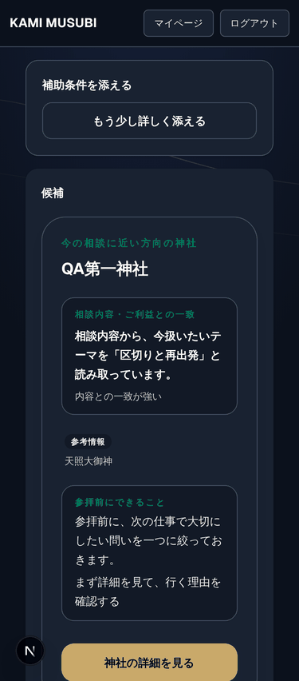
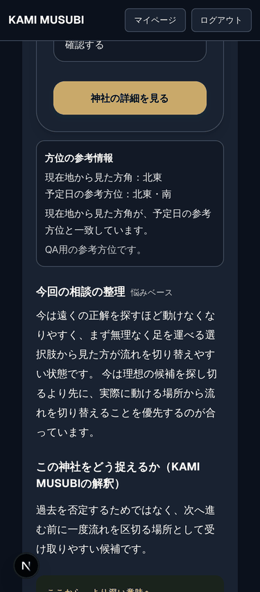
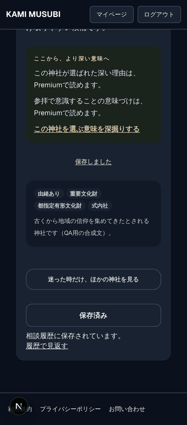
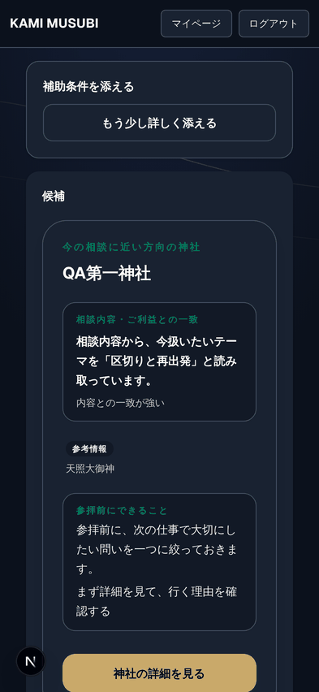
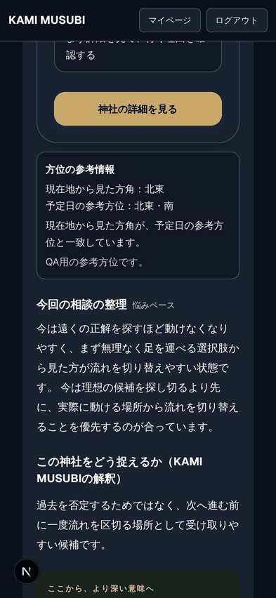
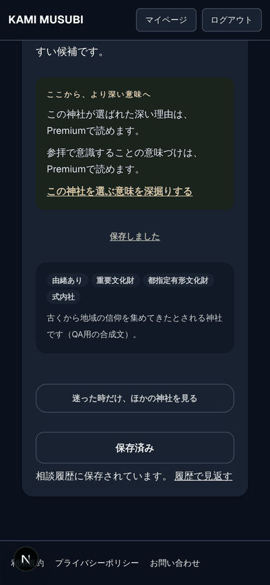

# Concierge Results Mobile QA（375 / 390 / 393px）

Status: Audit record（production code 変更なし）
実施日: 2026-10-22 / 基準: `develop` @ `6189ba35`（#3311 マージ後）

## 1. 実施方法

| 項目 | 内容 |
| --- | --- |
| 対象 | `/concierge?tid=500`（ログイン済み・Free） |
| 実行環境 | `next dev`（apps/web）+ Playwright Chromium（`isMobile`, `hasTouch`, DPR 3, iPhone Safari UA, 高さ 852px） |
| API | すべて `page.route` で mock。`/api/users/me/`・`/api/billings/status/`（free）・`/api/concierge-threads/`・`/api/concierge-threads/500/`・`/api/favorites/` |
| Fixture | 合成データのみ（`QA第一〜第四神社`、`shrine_id` 9001〜9004、`rid-qa-*`）。本番ユーザーデータ・本番 thread は不使用 |
| 計測 | `window.innerWidth` / `documentElement.scrollWidth` / `body.scrollWidth`、**実スクロールコンテナ `<main class="overflow-y-auto">` の `scrollWidth` / `clientWidth` と強制 `scrollLeft=200` 後の値**、viewport 外にはみ出す要素、ellipsis/overflow で切れる葉要素、`position: fixed/sticky`、全 tap target の寸法 |
| 状態 | 初期表示 / 「ほかの神社」展開 / 補助条件パネル展開 / お気に入り登録後 / 相談保存後 |

再現用スクリプト: [`assets/concierge-results-mobile-qa-2026-10-22/`](assets/concierge-results-mobile-qa-2026-10-22/)
（`fixture.mjs`, `audit.mjs`, `mainprobe.mjs`, `qa-env.mjs`）。実行手順は §8。

## 2. 結果サマリ

- **横スクロール: 全幅・全状態で PASS。**
  - 初期表示・ほかの神社展開・補助条件パネル展開の各状態で、3 幅とも `innerWidth == documentElement.scrollWidth == body.scrollWidth`。
  - `<main>` は `scrollWidth == clientWidth` で、`scrollLeft` を 200 にしても 0 のまま。
  - `html` / `body` の `overflow-x` は `visible` で、page レベルでの masking は無い。
- viewport 外にはみ出す要素は装飾 SVG（背景の曲線）のみ。祖先が `aria-hidden="true"` / `pointer-events-none` / `overflow-hidden` の装飾レイヤーで clip されており、コンテンツの masking ではない。
- console error / pageerror: 0 件（3 幅とも）。
- fixed / sticky 要素: `header` の sticky（高さ 59px）のみ。下部固定バーは無い。

| 幅 | innerWidth | documentElement.scrollWidth | body.scrollWidth | main sw / cw | ページ高 |
| --- | --- | --- | --- | --- | --- |
| 375 | 375 | 375 | 375 | 375 / 375 | 2227 |
| 390 | 390 | 390 | 390 | 390 / 390 | 2199 |
| 393 | 393 | 393 | 393 | 393 / 393 | 2199 |

## 3. Section 別 QA マトリクス

判定は 375 / 390 / 393 の 3 幅で共通（差異がある場合のみ記載）。

| # | Section（実装） | 判定 | 根拠 |
| --- | --- | --- | --- |
| 1 | Header / ナビ（layout `header`, sticky） | PASS | ロゴ `/`、マイページ `/mypage?tab=profile`、ログアウト（87×34px）。sticky で本文を覆う重なりなし。**ログアウトの実行は NOT TESTED**（セッション破棄のため） |
| 2 | 補助条件を添える（`filter` section → `ConciergeFilterPanel`） | PASS（軽微な指摘 QA-1） | 「もう少し詳しく添える」で展開し、展開後も横溢れなし。chip は 26px 高で折り返しは正常。パネルの「閉じる」は 34×17px（QA-1）。**「この条件で提案を更新」の実行は NOT TESTED**（chat API 呼び出しのため） |
| 3 | 候補 Hero（`ConciergeTopRecommendationHero`） | PASS | 神社名・結論・一致度ラベルの折り返し正常 |
| 4 | 推薦理由 / 御祭神（参考情報） / 参拝前にできること | PASS | 「参考情報 天照大御神」、行動提案 2 行とも clip なし |
| 5 | 神社詳細リンク（Hero「神社の詳細を見る」） | PASS | href `/shrines/9001?ctx=concierge&tid=500&direction_matched=1&direction_position=hero`。詳細ページ自体の QA は対象外 |
| 6 | 方位の参考情報（`DirectionReferenceCard`） | PASS | 4 行とも折り返し正常 |
| 7 | 今回の相談の整理（`ConciergeConsultationSummary`） | PASS（layout） | 段落折り返し正常。文面の妥当性は本 QA の対象外 |
| 8 | 今回の相談との接点（runtime match） | **NOT TESTED** | 本 fixture では描画されなかった（描画条件を満たす fixture 未作成） |
| 9 | この神社をどう捉えるか（history theme） | PASS | 見出し 2 行折り返し正常 |
| 10 | Premium section（`PremiumSeam`, Free） | PASS（軽微な指摘 QA-1） | CTA 「この神社を選ぶ意味を深掘りする」 href `/billing/upgrade`（遷移は未実行）。高さ 20px（QA-1）。**Premium 有効時・Guest 時は NOT TESTED** |
| 11 | 神社お気に入り CTA（`ShrineSaveButton` subtle） | PASS | 「この神社をお気に入り登録」→ click で `POST /api/favorites/` 1 回 →「保存しました」。28px 高 |
| 12 | 由緒・文化財（trust metadata） | PASS | chip 4 個は 2 行に正常に折り返し |
| 13 | ほかの神社 CTA + 候補カード（`ShrineCardCompact`） | PASS（軽微な指摘 QA-2, QA-3） | toggle は `aria-expanded` true/false、ラベル「ほかの神社を閉じる」⇔「迷った時だけ、ほかの神社を見る」。神社リンクは 1 → 4 件。「詳細だけ見る」で `/shrines/9002?...direction_position=other` へ遷移を確認 |
| 14 | 相談保存 / 保存済み / 履歴導線（save_prompt） | PASS | click で `GET /api/concierge-threads/` 1 回 →「保存済み」＋「相談履歴に保存されています。 履歴で見返す」。375px ではリンクが 2 行目へ（`whitespace-nowrap` で語中改行なし）。「履歴で見返す」で `/mypage/history/500` へ遷移を確認（遷移先ページの表示は対象外） |
| 15 | Footer | PASS（軽微な指摘 QA-1） | 利用規約 `/terms`、プライバシーポリシー `/privacy`、お問い合わせ（mailto）。リンクは 16px 高 |

### 対象外 / NOT TESTED（明示）

- **実機 iOS Safari / WebKit**: 本環境には Chromium のみで、WebKit は未インストール。以下は未検証。
  - dynamic toolbar による viewport 高さの変動
  - safe-area inset
  - 日本語フォント（Hiragino）のメトリクス
- Guest 表示、Premium 有効表示、fallback / dummy 表示、limit 到達表示。
- API エラー時の表示（既知の 502 は layout failure として扱わない方針のため、本 QA では mock で 200 固定）。
- ログアウト、補助条件の適用（chat API 再実行）。

## 4. 指摘一覧

| ID | Severity | Section | 内容 | 根拠 |
| --- | --- | --- | --- | --- |
| QA-1 | Low | Premium CTA / 補助条件「閉じる」 / Footer | tap target が 24px 未満のもの: Premium CTA 213×20、補助条件パネル「閉じる」34×17、footer リンク高 16。WCAG 2.2 SC 2.5.8 は spacing 例外があるため違反の確定ではない（判断要）。Apple HIG の 44pt は複数要素で未達 | `audit.mjs` の target 計測（3 幅共通） |
| QA-2 | Low | ほかの神社カード | 住所・理由文が 1 行の `truncate`（ellipsis）で、`title` などで全文を見る手段がカード上に無い（例: 住所 427px → 169px@375 / 187px@393）。詳細ページでは全文表示される前提なら意図通りの可能性あり | `w375-expanded.png`、clip 計測 |
| QA-3 | Low | ほかの神社カード | 画像が無い場合、空の画像枠（暗い角丸矩形）がそのまま表示される。本 fixture は `photo_url` 無し。本番データでの写真欠損率は未確認 | `w375-expanded.png` |
| QA-4 | Info | お気に入り / 相談保存 | お気に入り登録後の「保存しました」と、相談保存後の「保存済み」が近接し、どちらも「保存」表現。#3311 で未着手とした文言判断 | `w393-bottom-saved.png` |

dev 専用の Next.js 開発インジケータ（左下の「N」）が footer の「利用規約」に重なるが、production build では表示されないため指摘から除外。

## 5. 推奨する別タスク（任意）

1. QA-1: Premium CTA・補助条件「閉じる」・footer リンクの tap 領域を 24px 以上（可能なら 44px）に広げる。見た目を変えず padding で対応できるかを確認する。
2. QA-2 / QA-3: ほかの神社カードの truncate 方針と、写真欠損時の placeholder を決める（本番の写真欠損率の確認が先）。
3. QA-4: お気に入り登録後のラベル文言を決める。
4. 実機（iPhone 15 / iOS Safari）での確認、または WebKit を導入した環境での再計測。

## 6. Screenshots

`assets/concierge-results-mobile-qa-2026-10-22/`（1x に縮小した PNG）:
`w{375,390,393}-{top,middle,bottom,bottom-saved,expanded,filter-open}.png`

| 幅 | top | middle | bottom（保存後） |
| --- | --- | --- | --- |
| 375 |  |  |  |
| 393 |  |  |  |

## 7. 関連 test / 静的検査（コード変更なしの baseline）

- `vitest run src/features/concierge src/components/shrine src/app/concierge`: 64 files / 535 tests passed
- `tsc -p tsconfig.json --noEmit`: exit 0
- `eslint src/features/concierge src/components/shrine src/app/concierge`: exit 0

## 8. 再実行手順

### 前提条件

| 項目 | 内容 |
| --- | --- |
| Node / pnpm | リポジトリ既定の版。repo root で `pnpm install` 済みであること |
| Playwright | **新しい依存は不要**。`apps/web` の既存 devDependency `@playwright/test` を、`qa-env.mjs` がスクリプトからの相対位置（`../../../../apps/web/package.json`）で解決する |
| Chromium | 既定は Playwright 管理のブラウザ。未導入なら `pnpm --filter ./apps/web exec playwright install chromium` |
| Chromium（版が合わない環境） | `@playwright/test` の期待するブラウザ版が無く、別版が事前導入されている環境では、`PLAYWRIGHT_CHROMIUM_EXECUTABLE=<chromium 実行ファイル>` を指定する（§8 の注記参照） |
| 対象サーバ | `apps/web` の Next.js サーバ。`QA_BASE_URL` で指定（既定 `http://localhost:3000`、`apps/web/playwright.config.ts` の既定と同じ） |
| Backend | 不要。`/api/**` はすべて `page.route` で合成 fixture に置き換える |

### コマンド

```bash
# 1. 依存（初回のみ）
pnpm install
pnpm --filter ./apps/web exec playwright install chromium   # ブラウザ未導入の場合のみ

# 2. 対象サーバ（別ターミナル）
pnpm --filter ./apps/web exec next dev -p 3000

# 3. 計測（repo root から。カレントディレクトリには依存しない）
node docs/audit/assets/concierge-results-mobile-qa-2026-10-22/audit.mjs <screenshot-out-dir> > audit-result.json
node docs/audit/assets/concierge-results-mobile-qa-2026-10-22/mainprobe.mjs > main-scroll-result.json

# 任意: 幅の指定（既定 375,390,393）、別ポートのサーバ、版の合わない Chromium しか無い環境
node docs/audit/assets/concierge-results-mobile-qa-2026-10-22/audit.mjs <out-dir> 393
QA_BASE_URL=http://localhost:3100 node docs/audit/assets/concierge-results-mobile-qa-2026-10-22/audit.mjs <out-dir>
PLAYWRIGHT_CHROMIUM_EXECUTABLE=/path/to/chromium node docs/audit/assets/concierge-results-mobile-qa-2026-10-22/audit.mjs <out-dir>
```

- `audit.mjs`: 第 1 引数（screenshot 出力先）は必須で、無い場合は usage を出して exit 2。出力先が無ければ作成する。標準出力に幅ごとの計測 JSON（§2〜§4 の根拠）を出す。
- `mainprobe.mjs`: `<main>` スクロールコンテナの横スクロール計測 JSON（§2 の根拠）を出す。
- 出力 screenshot は DPR 3 の原寸。§6 の PNG は 1x に縮小したもの。

### 環境依存として残るもの（解消できない理由）

- **Chromium の版**: `@playwright/test` 1.63.0 は特定のブラウザ版を期待する。本 QA を実行した sandbox には別版の Chromium（`chromium-1194`）しか事前導入されておらず、上書き指定なしでは
  `Executable doesn't exist at .../chromium_headless_shell-1243/...` で起動に失敗する（再実行時に確認済み）。
  sandbox では `playwright install` によるブラウザ取得ができないため、実行ファイルを環境変数で渡す方式にした。
  ブラウザを取得できる通常の開発環境では、`playwright install chromium` 後に**環境変数なし**で実行できる。
- **WebKit / 実機**: §3 のとおり未検証。`qa-env.mjs` は Chromium のみを扱う。

### 再実行による確認（2026-10-22, 手順改善後）

repo root から `QA_BASE_URL` 既定値（`next dev -p 3000`）で、Chromium は `PLAYWRIGHT_CHROMIUM_EXECUTABLE` を指定して `audit.mjs` / `mainprobe.mjs` を再実行した。

- 3 幅で次の値が初回計測と一致した:
  - `innerWidth` / `scrollWidth` / ページ高 / `overflow-x` / はみ出し要素数
  - 24px 未満の tap target 一覧
  - favorite / 相談保存 / ほかの神社 toggle / 履歴遷移の結果（履歴遷移の URL はポート番号のみ異なる）
- `<main>` は全状態で `scrollWidth == clientWidth`、`scrollLeft` 0、横スクロール要素 0。console error 0。
- §2〜§5 の判定に変更なし。
